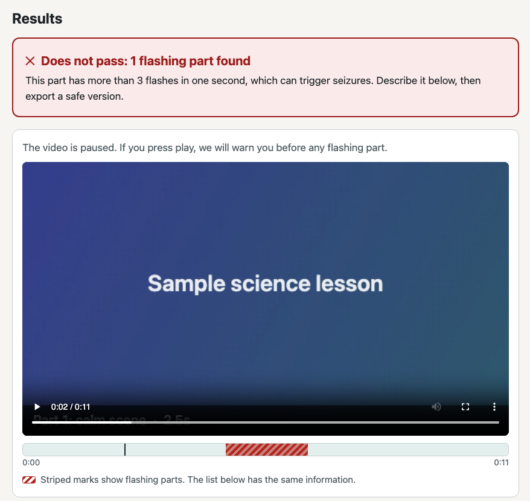
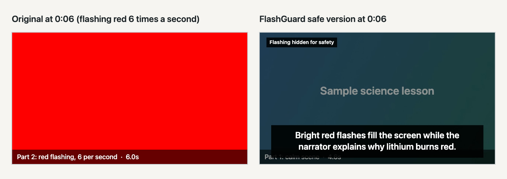

# FlashGuard

**Every student can watch the lesson.**

FlashGuard checks classroom videos for flashing that can trigger seizures, and turns them into a safer version with the flashing parts described in captions. It runs entirely in the browser, so videos never leave the teacher's device.

- **Live app:** https://flashguard-sooty.vercel.app
- **Source:** https://github.com/myramay/flashguard



---

## Learner story

**The learner.** Our intended learner is a high school student with photosensitive epilepsy. For this student, fast flashing light, especially saturated red, can trigger a seizure.

**The task.** The chemistry teacher assigns a demo video: a flame test, where metal salts burn in bright colours. Students watch it for homework and answer questions about what they saw.

**The barrier.** The teacher has no practical way to screen a video for flashing. Online videos often carry no warning. The usual workaround is to tell the student to look away during "bright parts", or to excuse them from the video entirely. Either way, the student misses the content that everyone else is assessed on. And they only find out where the risky parts are by watching.

FlashGuard is aimed at the step before the student ever presses play: the teacher checks the video, describes what happens in the risky parts, and shares a safer version with a clear warning.

## Before and after

We illustrate this with FlashGuard's built-in synthetic sample (a stand-in for a real flame-test video, generated in the browser so there are no copyright issues).

**Before.** From 0:05 to 0:07, the whole screen alternates between bright red and black about 6 times a second. That is double the WCAG limit of 3 flashes per second, and it is a red flash. The student is told to look away, and misses what happens.

**After.**
1. FlashGuard flags **0:05–0:07: red flash and general flash, 6 flashes per second, 94% of the screen**.
2. The teacher writes what happens: *"Bright red flashes fill the screen while the narrator explains why lithium burns red."*
3. The safe version holds a still, dimmed frame from just before the flashing, with that sentence shown as a large caption. The sound keeps playing.
4. The teacher pastes a ready-made warning where they share the link: *"This video contains flashing at 0:05–0:07. A seizure-safe version is available."*



## What it does

1. **Check.** Drag in an MP4 or WebM (or press "Try a sample video"). A progress bar shows how far along the check is.
2. **Review.** Get a plain pass/fail verdict, a timeline with each flashing part marked, and a list of parts with start and end time, type (general flash or red flash), flashes per second, and how much of the screen is affected. "Go to this part" moves the player to just before it, paused.
3. **Describe.** Each part has a text box, pre-filled with a draft such as "The whole screen flashes bright red quickly, about 6 times a second." The teacher rewrites it to describe the lesson content.
4. **Export a safe version.** Two options:
   - **Pause and describe** (default): flashing parts become a still, dimmed frame with the teacher's description as a caption.
   - **Reduce flashing**: keeps the motion but smooths it over time, and lowers contrast and colour. The caption is still shown.

   The new video downloads as `.webm`. FlashGuard then checks the exported file again and reports whether it passes.
5. **Warn.** "Copy content warning" gives a sentence ready to paste into a class page or email.

## How it works (plain language)

**The 3-flashes rule.** A *flash* is when a large part of the screen gets much brighter and then darker again, or the other way round. The international accessibility guideline WCAG 2.3.1 says a video should have **no more than 3 flashes in any one second**, unless the flashing area is small or the change in brightness is small.

**The red-flash rule.** Flashing that involves **strongly saturated red** is treated separately, because red is especially likely to trigger seizures. A change to or from saturated red counts as a flash even when the overall brightness change is fairly modest.

**What FlashGuard does with each video:**
1. Looks at 30 pictures for every second of video, shrunk to 160 pixels wide so it runs quickly.
2. Splits each picture into a grid and measures how bright each area is (using the standard "relative luminance" formula) and how strongly red it is.
3. Counts a *general flash transition* when areas covering at least a quarter of the screen change brightness by at least 10% (and the darker state is not already very bright). It counts a *red flash transition* when the change involves saturated red (red makes up at least 80% of the colour) and the red value shifts enough.
4. Two opposite transitions make one flash. Any one-second stretch with more than 3 flashes of either kind is marked, and nearby marked stretches are joined into one part.

All thresholds sit in one config object at the top of `src/detect.js`.

## Inclusive design choices

- **The app itself never flashes.** There are no animations or transitions anywhere in the interface (we checked: zero running animations). Because nothing moves, it already meets `prefers-reduced-motion` without a separate mode. The sample video is generated, analysed and exported on hidden off-screen canvases, so the teacher never sees it flash either.
- **The preview never autoplays.** If the teacher presses play, FlashGuard pauses just before any flagged part and asks: *Skip this part*, *Watch it anyway*, or *Stay paused*.
- **Captions replace what was removed.** Mitigation doesn't just hide visuals; the teacher's description of what happened takes their place, in large white text on a dark box. The sound is preserved.
- **Keyboard and screen reader.** Everything works by keyboard, with a visible 3 px focus ring. There's a skip link, and focus moves to each new screen's heading. All controls have proper labels, and a live region announces progress and results. The timeline has a text equivalent (the list of parts), and pass/fail uses words and icons, not colour alone.
- **Readable for everyone.** Plain-language copy, WCAG AA contrast in light and dark mode, and a layout that works at 375 px phone width.
- **Privacy by design.** No backend, no uploads, no analytics. Video, audio and descriptions stay in the browser tab. This matters for school content and for anything showing students.

## Built with

- **Vanilla JavaScript + Vite 6** (MIT): build tooling only; FlashGuard has no runtime dependencies.
- **Browser APIs:** HTML video, Canvas 2D, `MediaRecorder` and `canvas.captureStream()` for export, Web Audio for carrying the original sound into the export, Clipboard API.
- **Hosting:** Vercel (static site).
- **Testing:** Node's built-in `assert` for unit tests; **axe-core** (MPL-2.0, test-time only, not shipped) for the accessibility audit; gstack's headless Chromium for end-to-end runs.

### Credits

- Flash definitions come from **W3C WCAG 2.3.1 "Three Flashes or Below Threshold"** and its definitions of general flash and red flash thresholds. The approach follows the published **Harding / ITU-R BT.1702**-style method in simplified form. No code from those tools was used.
- The sample video is generated by our own code. No third-party video, images or audio are included.

### AI assistance disclosure

FlashGuard was built with **Claude Code** (Anthropic's coding agent, running Claude Opus 5.5). Claude Code wrote most of the code, the tests and this write-up, from a specification I wrote. It also ran the browser tests and the accessibility audit. I set the requirements, reviewed the results, and made the product decisions.

### Made during the event

All code, tests, screenshots and documentation were created during the hackathon. The project folder was created on 17 November 2026 at 22:58 EST, and the first commit was at 00:00 EST on 18 November 2026. No code from before the event was reused.

## Try it

**Online:** open https://flashguard-sooty.vercel.app in a recent Chrome or Edge and press **Try a sample video**. No sign-up, nothing to install.

**Locally:**

```bash
git clone https://github.com/myramay/flashguard.git
cd flashguard
npm install
npm run dev        # open http://localhost:5173
npm test           # detection unit tests
npm run build      # static site in dist/
```

## Limitations

- **It's an approximation, not a certification.** FlashGuard is a simplified version of the WCAG 2.3.1 and Harding-style rules. It is **not** a medical device and **not** a broadcast compliance certification. Use a certified analyser (such as PEAT or Harding FPA) for anything high-stakes.
- **Simplifications we made:**
  - The area rule is "at least 25% of the frame", not WCAG's size-and-viewing-distance rule.
  - Brightness is averaged over grid cells, so small or fine-grained flashing can be missed.
  - Frames are sampled at 30 per second, so very short flashes in 60 fps video can be missed.
  - Red is measured on averaged colour, not per pixel.
- **No pattern detection.** High-contrast stripes and checkerboards, which can also trigger seizures, are not detected.
- **Export is WebM** (VP9/VP8 video, Opus audio) and is recorded in real time: a 10-minute video takes about 10 minutes, and the tab must stay open and visible.
- **Audio caveats.** The original sound is carried into the export through Web Audio. If the browser blocks it, the export is silent and the app says so. We only verified audio in Chromium.
- **Tested only on synthetic clips.** All testing used videos generated in the browser. We did not test real camera or YouTube MP4 files, Safari or Firefox, or a real screen reader. We have not tested FlashGuard with teachers or students.
- **"Reduce flashing" is not guaranteed safe** on extreme content. That's why "Pause and describe" is the default and why every export is re-checked.
- **Analysis is slow on long HD video:** roughly real time at 720p, so about 5–10 minutes for a 10-minute lesson.

## What's next

- **Test with real people and real videos:** teachers screening their own lesson videos, and feedback from people with photosensitive epilepsy and their families on the captions and warnings.
- **Pattern (stripe/checkerboard) detection** and WCAG's viewing-distance-based area rule.
- **Real-world files:** test with H.264 MP4s from phones and video sites; export MP4 where browsers support it.
- **Faster analysis** using WebCodecs to decode frames directly instead of seeking.
- **Shareable reports:** a printable list of flashing parts and descriptions, plus caption files (WebVTT) for teachers who can't re-upload video.
- **A browser extension** that warns before flashing in videos students are already assigned.

## Testing evidence

What we actually ran (headless Chromium, Apple Silicon). The test scripts are in `tests/`.

| Test | Result |
|---|---|
| **Detection unit tests** (Node, synthetic frames) | Pass: sample timeline flagged correctly; 2.5 Hz passes; 4 Hz fails; very dim flashing passes; a second flashing part after a long pause is detected from its first flash (regression test for a bug we found) |
| **Sample video through the real UI** | 6 Hz red part flagged at **5.00–7.03 s** (true: 5.0–7.0 s), red + general, 6 flashes/s. 2 Hz white part **not flagged** |
| **Exported file, frame by frame** (both modes) | Plays with correct duration. In "Pause and describe", the picture inside the flagged part is frozen. **0 raw flash frames** within ±0.1 s of the part. Caption present on every frame. Normal motion elsewhere. The app's re-check passes |
| **30-second 1280×720 clip with audio** | Flagged **8.00–11.03 s** (red, 8 Hz) and **17.00–19.03 s** (white, 5 Hz); true: 8–11 s and 17–19 s. 2 Hz part not flagged. Analysis took 25–38 s. Export plus re-check about 46 s. Audio present in the export |
| **Keyboard-only pass** | Every control reachable and usable with Tab, Enter, Space, arrow keys and Escape. Logical order, visible focus. Pressing play before a flagged part stops within one frame and opens the warning; Escape closes it and returns focus to the player |
| **axe-core audit** (WCAG 2.2 A/AA + best practice) | **0 violations** on every screen (upload, checking, results, warning dialog, after export), in light and dark mode. Two items need a human: a decorative icon, and the teacher's own preview video having no caption track |
| **Layout and motion** | No horizontal scrolling at 375 px. Zero running animations or transitions |
| **Production smoke test** | Live site returns HTTP 200; sample flagged at 0:05–0:07 with no console errors |

Bugs found by this testing and fixed before submission:
- Freeze mode was holding a full red frame.
- A second flashing part was detected late after a calm stretch.
- Single flash frames leaked at segment edges.
- The export timeline was shifted by the player's start-up delay.
- Two accessibility issues: an unlabelled file input, and a missing page heading.
